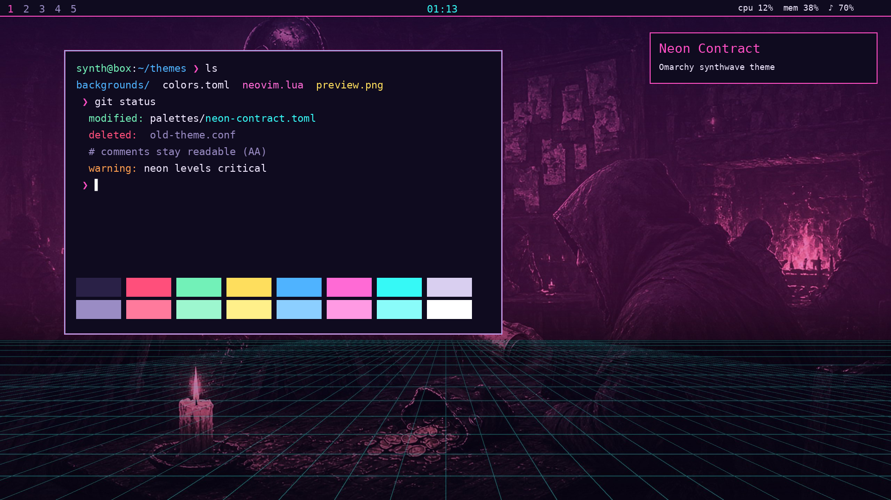
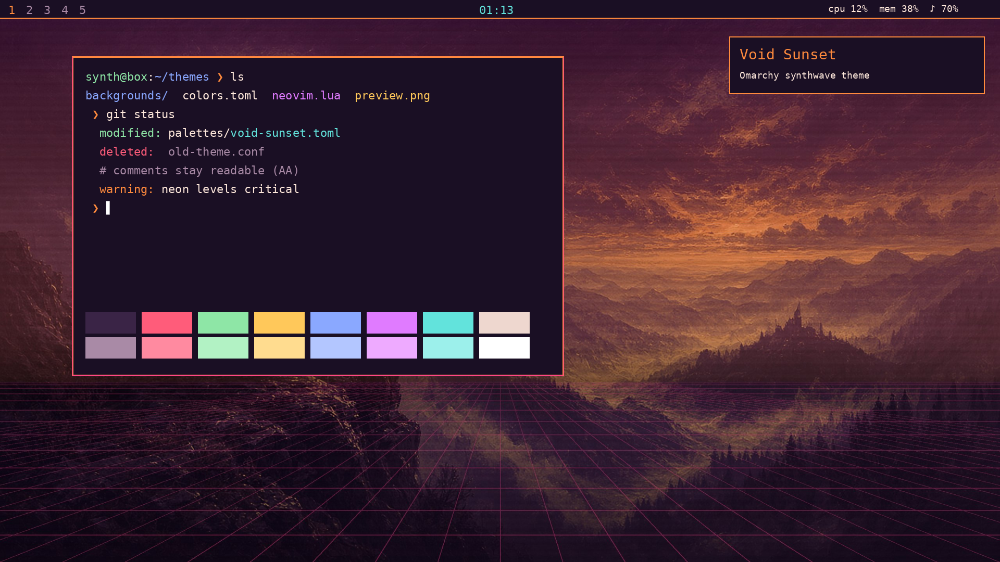
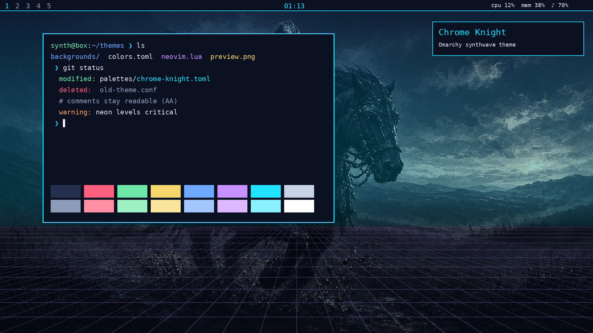

# Omarchy Synthwave Themes

Three synthwave themes for [Omarchy](https://omarchy.org): neon palettes, graded knight wallpapers with a grid horizon and scanlines, and matching configs. Every text color passes WCAG AA contrast, and CI checks that.

| Theme | Look |
|---|---|
| **Neon Contract** | Hot pink and ice cyan on a midnight violet background |
| **Void Sunset** | Ember orange and dusk magenta over a deep plum sky |
| **Chrome Knight** | Polished steel and electric cyan on a navy night |





## What's in a theme

`themes/<name>/` uses the Omarchy theme format, pinned to Omarchy `4.0.0.alpha` (basecamp/omarchy `b7e900c`, 2026-10-14):

- `colors.toml`: the palette. Omarchy uses it to render the Alacritty, Kitty, Ghostty, foot, Hyprland borders (gradient), btop, shell, mako and walker configs.
- `backgrounds/`: wallpapers at 2560x1440
- `neovim.lua`: a LazyVim colorscheme (tokyonight with the palette swapped in)
- `shell.lock.toml`: the lock screen
- `icons.theme`: a Yaru icon variant
- `preview.png`

`extras/<name>/` has standalone configs for older Omarchy releases (3.x, Waybar based) or plain Hyprland: `alacritty.toml`, `kitty.conf`, `ghostty.conf`, `hyprland.conf`, `waybar.css`, `mako.ini`, `walker.css` and `btop.theme`.

`wallpapers/<name>/<WxH>/` has every wallpaper at 1920x1080, 2560x1440, 3440x1440 and 5120x1440.

## Install

```bash
git clone https://github.com/Blackshield-Company/omarchy-synthwave-themes
cd omarchy-synthwave-themes
./install.sh list
./install.sh theme neon-contract                    # copies to ~/.config/omarchy/themes and applies it
./install.sh theme void-sunset --res 3440x1440      # use ultrawide wallpapers
./install.sh extras chrome-knight                   # legacy configs -> ~/.config/omarchy-synthwave/chrome-knight
```

After installing, switch themes from the Omarchy menu (Style > Theme) or with `omarchy-theme-set <name>`. To uninstall, delete `~/.config/omarchy/themes/<name>`.

## Develop

```bash
python3 -m venv .venv && .venv/bin/pip install -r requirements.txt
.venv/bin/python scripts/generate.py                     # configs from palettes/*.toml
.venv/bin/python scripts/generate.py --wallpapers --previews --art-dir /path/to/art
./validate.sh                                            # layout, contrast, config syntax, shellcheck, luac
.venv/bin/python -m unittest discover -s tests
```

To change a theme, edit `palettes/<name>.toml` and run the generator. Never edit the generated files by hand, because CI fails when they drift from the palette.

## License

MIT for the code and configs. The wallpapers are derived from Blackshield Company artwork.
